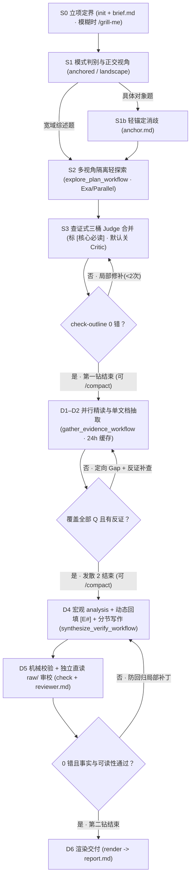

# Topic Research（双钻双技能深度调研）

**先发散摸底再收束定纲，先单文档精读再双轨成稿。** 本 Playbook 为纯调研任务，跳过代码改动与单测门禁，按顺序衔接内置双钻技能执行：
- **第一钻** `/topic-research-plan`（`skills/topic-research-plan/SKILL.md`）→ 交付过检动态大纲 `outline.md`
- **第二钻** `/topic-research`（`skills/topic-research/SKILL.md`）→ 交付过审报告 `report.md`

报告写盘交付，聊天回复只交路径、3–6 条核心结论与主要空白。

## 双钻状态机流程图

## 核心五原则

- **第一钻自适应入口，三桶收束防幻觉**：具体对象题先 1 步轻锚定防同名漂移，宽域题直接 2–3 正交视角轻搜（机制路走“综述→带窗高引→近半年”，论文/代码 web 检索分流 Exa）；查证式 Judge 按「主线 / 对照 / 同名排除」三桶裁决、核原文血缘并标 `[核心必读]`，**线索≠证据**，默认关 Critic。
- **限定范围，本地缓存免重复抓**：按大纲排除项锁定高信噪比渠道（Parallel / Exa / alphaXiv / OpenAlex / GitHub），`research.py fetch/pdf` 内置 24h 本地缓存保护 `alphaXiv` 配额；JS 抓空页用 `/browser` 兜底。
- **持久多跳，先宽后窄**：`gather_evidence_workflow.py` 先批量精读 `[核心必读]`，再由强模型执行 1 轮定向 Gap + 反证（`contradicts`）补查，高层骨架冻结、子节允许局部增量调纲（≤2 次）。
- **有用性筛选，单文档原文落盘**：轻量 `flash` 代理按 `extractor.md` 逐篇去噪落盘原句、条件与定位符，**严禁跨文档二手压缩**（避开 62%–70% 错率悬崖与论断平滑）。
- **强模型定调，双轨审校防回归**：`synthesize_verify_workflow.py` 先写宏观 `analysis.md` 与归属权，再按节定点取 `[E#]` 并行写作（`writer.md`：结论先行、短段 ≤250 字、`
` 折叠），经 `report.py check` + 独立直读 `raw/` Reviewer 审校（防 Evidence-View Gaming）+ 防回归局部补丁后 `render`。

## 执行步骤与原生联动

1. **第一钻（`/topic-research-plan`）**：`S0` 建目录写 `brief.md`（需求模糊先 `/grill-me`）→ `/run-workflow` 运行 `skills/topic-research/scripts/explore_plan_workflow.py`。**结束条件**：`report.py check-outline` 0 错、`Q1..Qn` 全覆盖、排除项入 `## 全局研究边界`、0 条 `[E#]`（完成后可 `/compact`）。
2. **第二钻 · 发散 2（`/topic-research`）**：`/run-workflow` 运行 `skills/topic-research/scripts/gather_evidence_workflow.py`（并行 `flash` 单文档抽取 + 确定性覆盖统计 + 强模型 Gap & 反证补查；JS 抓空用 `/browser` 兜底；完成后可 `/compact`）。
3. **第二钻 · 收束 2（`/topic-research`）**：`/run-workflow` 运行 `skills/topic-research/scripts/synthesize_verify_workflow.py`（`analysis.md` + 动态回填 `[E#]` + 并行分节写作 + `check` + 独立直读 `raw/` 审校 + 防回归局部补丁 + `render`）。`deep` 档无人值守配 `/goal`。
4. **克制原则**：主干不叠加 `/swarm`、`/teamwork`、`/boost` 或 `/plan`，避免破坏隔离性与预算门禁。

**Reply:** 报告文件路径、3–6 条核心结论、主要局限与未解空白（不粘贴报告正文）。
