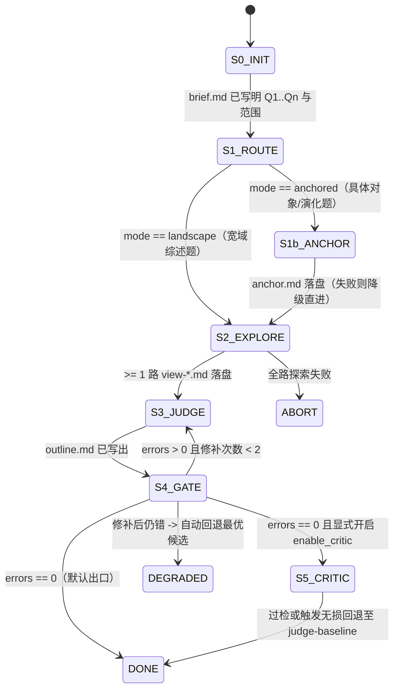

# Topic Research Plan（第一钻：探索与定纲）

**目标**：把用户的原始 Prompt，经 **发散 1（摸清版图）→ 收束 1（三桶裁决 + 核实血缘）**，转化为一份可执行、带明确排除边界、且通过机器校验的动态大纲 `outline.md`，供第二钻 [`topic-research`](../topic-research/SKILL.md) 深挖取证。

**核心边界**：第一钻只产出**搜索契约与线索**，**绝不写最终报告，绝不写入 `sources.jsonl` / `evidence.jsonl`，绝不在 `outline.md` 里放 `[E#]` 引用**。

共用脚本位于仓库根目录（相对本文件 `../topic-research/scripts/`，Antigravity 下即 `~/.gemini/config/plugins/pstack/skills/topic-research/scripts/`）：
- 检索 CLI：[`scripts/research.py`](../topic-research/scripts/research.py)
- 目录与校验 CLI：[`scripts/report.py`](../topic-research/scripts/report.py)
- Antigravity 自动编排：[`scripts/explore_plan_workflow.py`](../topic-research/scripts/explore_plan_workflow.py)
- 大纲格式契约：[`references/outline-spec.md`](../topic-research/references/outline-spec.md)

---

## 状态机总览



---

## 各阶段职责、转移条件与结束条件

| 状态 | 做什么（极简动作） | 产出物 | 转移条件（进入下一状态的硬门禁） |
|---|---|---|---|
| **`S0 · INIT`**<br>立项定界 | 运行 `report.py init "<topic>" --request "<原话>" --tier quick\|deep`，填好 `brief.md`（问题 `Q1..Qn`、约束、排除项、预算）。需求模糊或易同名混淆时，可先用 `/grill-me` 3–5 问对齐边界。 | `brief.md` | `brief.md` 至少有 1 条清晰 `Q#` 且范围无致命歧义 → 进入 **`S1`**。 |
| **`S1 · ROUTE`**<br>判别模式与生成视角 | 读 `brief.md`，判断入口模式并生成 `2`（`quick`）或 `3`（`deep`）个正交视角（切面 + 渠道 + 种子词错位）。 | 视角列表 + `mode` | • 指向具体算法/优化版/易同名混淆 → `mode=anchored` → 进 **`S1b`**<br>• 宽域综述/多路线选型 → `mode=landscape` → 直进 **`S2`** |
| **`S1b · ANCHOR`**<br>对象锚定（仅 `anchored`） | 最多 2 次轻搜 + 2 次读原文摘要/引言（`pdf`/`fetch`/`repo`），确认目标精确定义、前身对象与同名异域排除词。 | `notes/plan/anchor.md` | `anchor.md` 落盘 → 进 **`S2`**（若失败则记录日志，降级直进 **`S2`**）。 |
| **`S2 · EXPLORE`**<br>多视角隔离轻探索（发散 1） | 并行隔离跑 2–3 路轻搜（每路 2–4 次检索）与实体普查；`mechanism` 路固定走 **“定向综述 → 不足 2 篇回退带窗高引 → 补近半年防滞后”** 三阶梯（综述仅作地图，线索指一手原文）。 | `notes/plan/view-*.md`<br>`raw/explore-*.json` | • `>= 1` 路（目标 `>= 2` 路）有效落盘 → 进 **`S3`**（单路超时自动降级，不拖垮全组）<br>• `0` 路成功 → **`ABORT`** 报错退出。 |
| **`S3 · JUDGE`**<br>查证式三桶合并（收束 1） | 读全部候选做 **三桶裁决**：① 核心主线（定唯一章节归属权）；② 纵横向对照（控篇幅）；③ 同名异域噪声（**写入 `## 全局研究边界` 排除项**）。遇分歧或血缘存疑，必调 `pdf`/`fetch`/`repo` 核原文，未核实标 `待验证假设`。 | `outline.md` | `outline.md` 写入磁盘（按 `outline-spec.md` 4 块格式）→ 进 **`S4`**。 |
| **`S4 · GATE`**<br>确定性门禁与修补/回退 | 纯代码跑 `report.py check-outline <run_dir>`，校验非 JSON、编号连续、`>= 3/6` 小节、4 块齐全、`Q1..Qn` 全覆盖、零 `[E#]`。 | `notes/plan/judge-baseline.md` | • `errors == 0`：锁定基线，默认 **`DONE`**（若显式设 `enable_critic=True` 才进 **`S5`**）<br>• `errors > 0` 且修补 `< 2` 次：回 **`S3`** 局部修补<br>• 仍失败：回退报错最少的 `view-*.md` → **`DEGRADED`**。 |
| **`S5 · CRITIC`**<br>可选缺口核查（默认关闭） | 仅超宽域综述手动开启。独立 Critic 搜漏标 `HP1..HP5` → Judge 吸收或显式拒绝 → 跑 `check-outline --critique --baseline`。 | `notes/plan/critic.md` | 过检 → **`DONE`**；若漏 `HP#` 或丢失基线 URL/实体，硬回退 `judge-baseline.md` → **`DONE`**。 |

---

## 结束条件（Done Contract）

同时满足以下 4 条，第一钻结束并交接给第二钻 [`topic-research`](../topic-research/SKILL.md)：
1. `report.py check-outline <run_dir>` 返回 **`errors: []`**（退出码 `0`）；
2. `brief.md` 的全部 `Q1..Qn` 均已落位，且 `## 全局研究边界` 写清了时间窗与同名排除项；
3. 每节 `### S<k>.<m>` 具备完整 4 块（`内容范围` / `研究问题` / `必需实体 / 案例` / `来源线索`），且 **0 条 `[E#]` 引用**；
4. 聊天回复只报告：`run_dir`、`mode`（`anchored`/`landscape`）、`outline.md` 路径、章节/实体计数与主要待核假设（不贴大纲全文）。

---

## 执行方式

### Antigravity（推荐一键执行）
先完成 `S0`（`report.py init` + 填写 `brief.md`，模糊需求可先用 `/grill-me`），随后直接调用 `/run-workflow` 自动跑完 `S1 → S4`（默认关 Critic）；第一钻落盘完成后，建议在切入第二钻前执行一次 `/compact` 释放主会话上下文（`brief.md` 与 `outline.md` 均已落盘）：

```python
run_workflow(
    ScriptPath="<skill_root>/scripts/explore_plan_workflow.py",
    Description="Diamond 1: adaptive explore and dynamic outline",
    Args={
        "run_dir": "<abs_run_dir>",
        "tier": "deep",           # quick | deep
        # "mode": "anchored",     # 可选：强制 anchored 或 landscape
        # "enable_critic": False, # 默认 False；超宽域综述可按需设为 True
    },
)
```

### 其他运行时（Claude Code / omp / Shell 降级）
按上表状态机手动推进：`S0` 建目录写 `brief.md` → `S1/S1b` 必要时轻读锚定写 `anchor.md` → `S2` 派 2–3 个独立子代理（或顺序视角）写 `notes/plan/view-*.md` → `S3` 查证式三桶合并写 `outline.md` → `S4` 跑 `python3 scripts/report.py check-outline <run_dir>` 校验过关。
