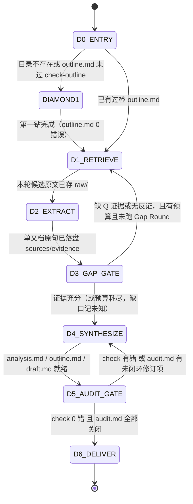

# Topic Research（第二钻：深挖取证与成稿交付）

**目标**：承接第一钻 [`topic-research-plan`](../topic-research-plan/SKILL.md) 产出的过检动态大纲 `outline.md`，经 **发散 2（划范围持久精读 + 单文档落盘）→ 收束 2（强模型分析、高可读写作与双轨审校）**，交付可溯源的 `report.md`。聊天回复**只交报告路径、3–6 条核心结论与主要空白**，绝不粘贴正文。

**防失真底层逻辑**：信息在三处最易丢失——上下文溢出、子代理跨文档二手压缩、靠记忆一次性写稿。因此所有证据读完即落盘（单文档原句 + 定位符），写手读文件不读聊天历史，引用经机械 + 独立审校核回原文。

两个零依赖脚本（Python 3.9+，Antigravity / Claude Code / omp / Shell 通用）：
```bash
R="python3 <this skill's directory>/scripts/research.py"   # web, fetch, papers, pdf, repos, repo, usage, hn, ledger, doctor
P="python3 <this skill's directory>/scripts/report.py"     # init, source, evidence, check-outline, check, render
$R doctor                                                  # 检查当前可用检索渠道（不打印密钥）
```
不要拿运行时自带网页摘要当证据（片段过短或经模型改写）；一律用 `$R web` / `fetch` / `pdf` / `repo` 且传 `--save <run>/raw/<step>.json --brief` 把原始 JSON 留在磁盘。

---

## 状态机总览



---

## 各阶段职责、转移条件与结束条件

| 状态 | 做什么（极简动作） | 核心产出 | 转移条件（进入下一状态的硬门禁） |
|---|---|---|---|
| **`D0 · ENTRY`**<br>入口契约检查 | 检查运行目录与 `outline.md` 是否已通过 `$P check-outline $D`。 | 入口确认 | • 已通过 → 直进 **`D1`**<br>• 未建目录或无过检 `outline.md` → **先执行第一钻 [`topic-research-plan`](../topic-research-plan/SKILL.md)**，过检后进 **`D1`**。 |
| **`D1 · RETRIEVE`**<br>划范围多跳检索与精读（发散 2） | 严格按 `outline.md` 的 `必需实体`、`来源线索` 与 `全局研究边界`（排除项），分渠道检索（`web` / `papers` / `repos` / `hn`），按 [`rubric.md`](./references/rubric.md) 淘汰 `R <= 1`，对高价值候选做**整文/按页精读**（`pdf` / `fetch` / `repo`；遇重度 JS 渲染或防爬抓空页时，Antigravity 下可用 `/browser` 实机精读兜底）。 | `raw/*.json` | 高价值候选原文已落盘 `raw/` → 进 **`D2`**。 |
| **`D2 · EXTRACT`**<br>单文档有用性清洗落盘 | 逐篇读 `raw/`（或派轻量模型按 [`extractor.md`](./references/extractor.md) 执行），筛掉噪声后立即调用 `$P source`（同项目共用 `--family`）与 `$P evidence`（原句、精确 `--locator`、数字 `--conditions`、`--question Q#`、反证 `--stance contradicts`）。**严禁跨文档合并压缩。** | `sources.jsonl`<br>`evidence.jsonl`<br>`notes/<id>.md` | 本轮精读文档全部完成落盘 → 进 **`D3`**。 |
| **`D3 · GAP_GATE`**<br>覆盖度与反证判断门 | 对照 `brief.md` 的 `Q1..Qn` 与 [`rubric.md`](./references/rubric.md) 评分（`tentative` 归入“待验证”），检查是否仍有必答 `Q#` 缺合格证据或主推荐缺反证/负面复现。 | 缺口清单 | • 有缺口/无反证，且预算有余且未跑过 Gap Round → 回 **`D1`** 跑 **1 轮定向 Gap Round**（可加 `--mode advanced` / `--difficulty`）<br>• 否则 → 进 **`D4`**（补不到的如实写“未知及已尝试路径”，绝不硬凑）。 |
| **`D4 · SYNTHESIZE`**<br>强模型分析、动态调纲与写作（收束 2） | ① 基于落盘文件写 `analysis.md`（每题答案、`[E#]`、冲突原因、条件、未知，自推断标 `[推断]`）；<br>② 动态微调并将核实 `[E#]` 回填至 `outline.md`（最多调纲 2 次），贴合 [`report-template.md`](./references/report-template.md)；<br>③ 写 `draft.md`：`quick` 单次通写，`deep` 按 [`writer.md`](./references/writer.md) 分节新上下文写（结论先行、短段 ≤250 字、紧凑表格、`<details>` 折叠明细、章节归属防重复，最后写总结论）。 | `analysis.md`<br>`outline.md`（绑定 `[E#]`）<br>`draft.md` | `draft.md` 全部章节就绪（不含自写参考文献节）→ 进 **`D5`**。 |
| **`D5 · AUDIT_GATE`**<br>双轨审校门禁 | ① 跑 `$P check $D` 查未知 `[E#]`、格式错、无引数字、漏 `Q#`；<br>② 独立子代理按 [`reviewer.md`](./references/reviewer.md) 对照 `raw/` 核查全部关键数字、主推荐与抽样声明（含 `deep` 档反证复核与可读性/归属权审查），写入 `audit.md`。 | `audit.md` | • `$P check` 报错或 `audit.md` 存在必改项 → 回 **`D4`** 修订（补证/收窄/标未知/删改，禁硬挂不相关引用）并重过 **`D5`**<br>• `$P check` **0 错** 且 `audit.md` 修订全闭环 → 进 **`D6`**。 |
| **`D6 · DELIVER`**<br>渲染与精简交付 | 跑 `$P render $D` 生成 `report.md`（`[E#]` 转编号并生成参考文献表）；方法节填入 `$R ledger --since <started>` 计数与估算花费。 | `report.md` | **`DONE`**：聊天只回报告路径、3–6 条核心结论与主要局限/空白。 |

---

## 结束条件（Done Contract）

同时满足以下 4 条，第二钻完成：
1. `$P check $D` 返回 **0 errors**（且无未解释的关键告警）；
2. `audit.md` 已记录逐项核验结果与修订闭环；
3. `report.md` 已由 `$P render $D` 生成落盘，方法节包含账本计数与估算花费；
4. 聊天回复仅含文件路径、核心结论与主要空白（不贴报告正文）。

---

## 运行目录与预算档位

| 文件 | 归属阶段 | 内容 |
|---|---|---|
| `brief.md` / `outline.md` / `notes/plan/` | 第一钻 → `D4` | 立项需求与动态大纲（第一钻产出线索蓝图，`D4` 回填 `[E#]`） |
| `raw/` | 第一钻 & `D1` | 全部检索与精读原始 JSON（含 `--from` 批量文件） |
| `sources.jsonl` / `evidence.jsonl` | `D2` | 加锁追加的来源与单文档原句库（支持并发 worker 安全共享） |
| `analysis.md` / `draft.md` / `audit.md` / `report.md` | `D4`–`D6` | 综合分析、带 `[E#]` 草稿、独立审校记录、最终交付报告 |

| 档位 | 适用场景 | 检索 / 精读预算 | 写作与审校 |
|---|---|---|---|
| `quick` | 单一明确问题、资料清单或快速决策 | ≤ 20 / ≤ 10 | 单次通写 + `check` + 关键数字/推荐复核 |
| `deep`（默认） | 深度综述、架构选型或多子问题调研 | ≤ 40 / ≤ 25 | 按 [`writer.md`](./references/writer.md) 分节写 + `check` + 完整 [`reviewer.md`](./references/reviewer.md) + 反证复核 |

> 计数口径：第二钻预算与第一钻独立计算（且可直接复用 `raw/explore-*.json` 中已落盘文件，不重复抓取）。每次 `web` 查询词 / `papers` / `repos` / `hn` 计 1 次检索；每次 `fetch` URL / `repo` / `pdf` 计 1 次精读；`paper`/`usage` 富化各 ≤ 10。务必为 `D3` 预留 1 轮 Gap Round 预算。

---

## 并发、模型分层与 Antigravity 原生映射（其他环境可忽略）

- **三段原生 `run_workflow` 编排脚本**（按阶段断点续跑，钻间可 `/compact` 清窗）：
  1. **第一钻（`S1–S4`）**：[`scripts/explore_plan_workflow.py`](./scripts/explore_plan_workflow.py)（自适应 `anchored`/`landscape` + 3 路正交探索含 Exa 分流 + 三桶 Judge + `check-outline`）
  2. **第二钻 · 发散 2（`D1–D3`）**：[`scripts/gather_evidence_workflow.py`](./scripts/gather_evidence_workflow.py)（解析 `[核心必读]` 线索队列 → 并行隔离 `flash` 单文档抽取落盘 + 24h 本地 `fetch`/`pdf` 缓存 → 确定性覆盖度审计 → 强模型 Gap & 反证补查）
  3. **第二钻 · 收束 2（`D4–D6`）**：[`scripts/synthesize_verify_workflow.py`](./scripts/synthesize_verify_workflow.py)（强模型宏观 `analysis.md` + 动态回填 `[E#]` → 并行分节定点写稿 → `check` 门禁 → 独立直读 `raw/` Reviewer 审校 → 防回归局部补丁 + `render`）
- **主干原生联动（4 + 1，确认有用才用）**：
  - 需求模糊/强上下文立项（`S0`）→ `/grill-me` 先对齐约束与排除项；
  - 批处理编排（`S1–S4`、`D1–D3`、`D4–D6`）→ `/run-workflow`；
  - 阶段切换点（第一钻→第二钻、`D3→D4`）→ `/compact` 清窗（产物均已落盘）；
  - JS 渲染/防爬抓空兜底（`D1`）→ `/browser` 实机精读；
  - `deep` 档无人值守全程 → `/goal` 守护至 Done Contract 全部满足。
  - **避免叠加**：不推荐在主干叠加 `/swarm`（共享板易互相锚定且未训 Swarm 实证掉点）、`/teamwork`、`/boost` 或 `/plan`（与双钻状态机职责重叠）。
- **单文档筛选与抽取（`D2`）**：默认由 `gather_evidence_workflow.py` 用 `flash` 批处理扇出（手动跑时用 `invoke_subagent(..., Model="flash")` 配合 [`references/extractor.md`](./references/extractor.md)），逐篇去噪并调用 `$P source` / `$P evidence --by <worker>`，仅回传 `<= 8` 行摘要。
- **分析、分节写作与独立审校（`D4`–`D5`）**：保持主模型 `Model="inherit"`（读 [`references/writer.md`](./references/writer.md) 与 [`references/reviewer.md`](./references/reviewer.md)），确保冲突裁决、`[E#]` 绑定、可读性门禁与直读 `raw/` 原文审校不降级。
- **并发拆分原则**：按问题或独立切片拆分，不按渠道拆；多个 worker 重复读同一来源仍按同一 `family` 计 1 次独立来源（`research.py fetch/pdf` 已内置 24h 本地缓存，`--no-cache` 可绕过）。

---

## 渠道与密钥安全

默认网页检索走 `parallel`（无密钥自动降级 MCP）；论文/代码/文档分类用 `exa`，中文源用 `deepseek`，网页抓取兜底用 `jina`。完整渠道策略与可选密钥配置（`~/.config/secrets/keys.env` + [`.env.example`](./.env.example)）见 [`references/providers-and-keys.md`](./references/providers-and-keys.md) 或运行 `$R doctor`。

**密钥安全红线**：绝不打印密钥值、`cat` 密钥文件、索要用户粘贴密钥或将密钥写入报告；若对话中意外出现密钥，立刻提醒用户去服务商轮换。

## 核心反模式（严禁触发）

- 靠聊天记忆写稿，而非读 `evidence.jsonl`、`analysis.md` 与 `raw/` 原文；
- 在聊天窗口粘贴报告全文或冗长复述；
- 一条引用糊弄整段/整表，或给不支持该断言的句子强挂相近链接；
- 在弱子代理中做多文档联合压缩（单文档抽取极稳，多文档压缩错误率飙升至 62%–70%）；
- 把综述、榜单、厂商对比页当最终证据而不追查一手原文；把同一项目的论文+博客+仓库算成多个独立来源；
- 隐瞒未知项、未实测运行却暗示已部署、或用退场来源（Open LLM Leaderboard / paperswithcode.com / Bing Search API）；
- 首轮烧光检索预算，不给 `D3` 留 Gap Round。
